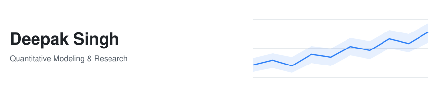
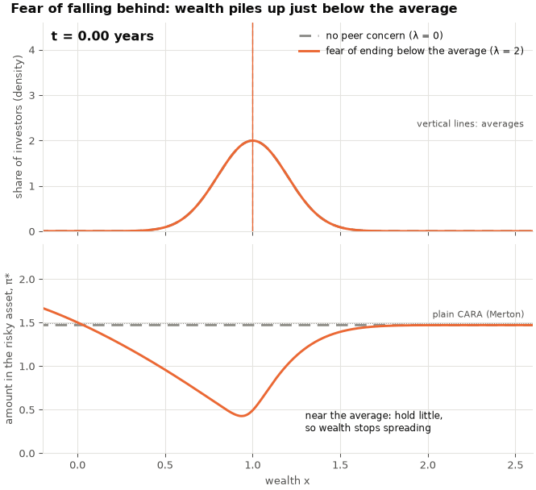
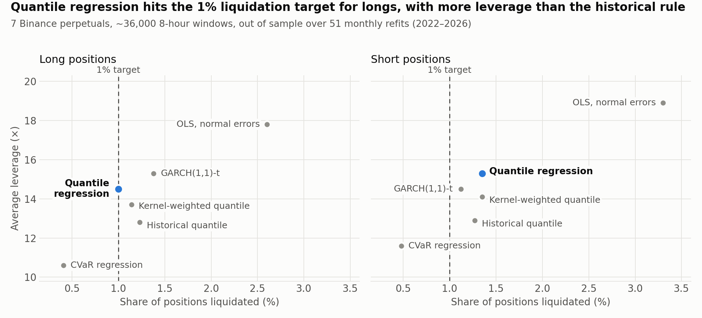

  

I'm a graduate student in Applied Mathematics and Statistics at Stony Brook University, concentrating in
quantitative finance. I like to analyze a model mathematically before I build it: whether its structure
fits the problem, whether its likelihood or loss targets the right quantity, and what goes wrong when
either is misspecified. That analysis shapes which model I choose, how I implement it and how I test it.

My background in software engineering helps me put these ideas into practice, from implementing models
and numerical solvers to building research pipelines and trading systems. I've applied this combination
through equity alpha research at SMB Capital and independent quantitative development work.

## 🧭 Research Interests

- **Sequential decision-making and online learning:** stochastic control, reinforcement learning and adaptive
  control, with a focus on exploration and learning dynamics: how fast methods converge on real problems
  and what bounds they come with.
- **Statistical modeling and inference:** how the estimation target and assumptions about the data-generating
  process guide the choice of models and estimators. I'm interested in robustness to model misspecification
  and finite-sample performance, especially for nonparametric and high-dimensional methods: kernel methods,
  low-rank estimation and random matrix theory.
- **Applications in quantitative finance:** alpha discovery, dynamic portfolio construction, derivatives pricing,
  and optimal quoting in market making.

I'm currently exploring **neural PDE methods for stochastic control** and **computational methods for inference**.

---

## 🔬 Recent Work

### Fear of falling behind: a mean-field game of portfolio choice under peer-shortfall risk

*How does a crowd of investors invest when each one fears ending the year below the average?*

Each investor chooses how much to put in a risky asset and is penalised for ending below the
population's average wealth. That average is itself the result of everyone's choices, so the
problem is a **mean-field game**: an HJB equation for each investor's best strategy, a
Fokker–Planck equation for how the population's wealth evolves, and a fixed point where the
average investors plan against is the average they produce. It has the same structure as
heterogeneous-agent macro models (Aiyagari; Achdou, Han, Lasry, Lions & Moll), with peer
comparison in place of an interest rate.

**What we did**
- Found that the problem as originally posed let peers have no effect on anyone's choices, and
  redesigned the penalty so individual strategies and the crowd shape each other.
- Built finite-difference solvers for both equations and the equilibrium search as the benchmark,
  with errors of about 10⁻⁶ (checked against the exact no-penalty solution and by grid
  refinement).
- Solved the same system with **physics-informed neural networks** (PyTorch), matching the
  benchmark equilibrium to 0.014%.
- Extended the model to an **N-player Nash equilibrium**, solving PDEs in up to 21 variables with
  PINNs, where grid methods are infeasible.

**What it shows**
- Fear of falling behind **halves** the average amount invested in the risky asset, and wealth
  piles up just below the average.
- The population's average one-year return falls from **11.0% to 6.5%**: competing on relative
  performance costs everyone return.
- The result barely depends on what investors expect: any belief about the average between 1.0
  and 1.3 leads to a realised average between 1.059 and 1.070.

`Python` · `PyTorch` · `NumPy/SciPy` · finite differences · PINNs · AMS 516, Stony Brook · joint work with Ander Ibarrondo

---

### Forecasting tail quantiles: how much leverage is safe on crypto perpetual futures?

*When the quantity you need is a 1% tail quantile, should you model it directly, or model the whole
return distribution and read the quantile off?*

On a crypto perpetual future with isolated margin, a position at leverage `L` is liquidated when its
worst adverse move over the holding window reaches `1/L − mmr` (mmr: maintenance margin rate). Keeping
the chance of liquidation at α means forecasting the α-quantile of that move and setting
`L = 1/(mmr + |q̂_α|)`. Leverage is a direct readout of the forecast: overstate the tail and you give
up leverage; understate it and positions are liquidated more often than promised.

**What we did**
- Compared six estimators of the conditional tail quantile: distributional models (OLS with normal
  errors, GARCH(1,1)-t), direct quantile models (historical quantile, linear and kernel-weighted
  quantile regression) and a conservative CVaR regression.
- Fitted quantile regression pooled across coins with coin fixed effects on four market-state
  factors (funding, open-interest change, realized volatility, basis), using PSG.
- Evaluated out of sample on 7 Binance perpetuals (about 36,000 8-hour windows, 2022–2026) with 51
  monthly walk-forward refits, testing liquidation rates for correct coverage (Kupiec) and
  independence (Christoffersen).

**What it shows**
- **Modelling the quantile directly wins.** Pooled quantile regression liquidated 1.00% of long
  positions at a 1% target, with all 7 coins within Kupiec bounds, at **13% more leverage** than the
  historical-quantile rule (14.5× vs 12.8×).
- **Distributional models pay for misspecified tails.** Normal tails are too thin: OLS liquidates
  2.6–3.3% at a 1% target. GARCH-t's extra leverage for longs comes with extra liquidations (1.38%).
- **More flexibility did not help.** The nonparametric kernel model did not beat linear quantile
  regression.
- **CVaR regression is conservative by design:** well below target, with a quarter to a third less
  leverage than quantile regression.
- **Limitations:** at 1% short, every method except CVaR liquidates too often (GARCH-t comes closest,
  at 1.12%); liquidations cluster in time; fees and funding are excluded.

Full results: liquidation rate / average leverage, out of sample

| Method | 1% long | 1% short | 5% long | 5% short |
|---|---|---|---|---|
| Historical quantile | 1.23% / 12.8× | 1.27% / 12.9× | 5.01% / 20.7× | 5.16% / 21.2× |
| OLS, normal errors | 2.60% / 17.8× | 3.30% / 18.9× | 4.81% / 22.1× | 5.75% / 23.4× |
| GARCH(1,1)-t | 1.38% / 15.3× | 1.12% / 14.5× | 6.11% / 24.8× | 5.75% / 24.1× |
| **Quantile regression** | **1.00% / 14.5×** | 1.35% / 15.3× | 4.76% / 23.6× | 5.31% / 23.9× |
| Kernel-weighted quantile | 1.14% / 13.7× | 1.35% / 14.1× | 5.08% / 22.9× | 5.59% / 23.2× |
| CVaR regression | 0.41% / 10.6× | 0.48% / 11.6× | 1.43% / 16.1× | 1.83% / 17.0× |

`Python` · `statsmodels` · PSG · quantile regression · GARCH · CVaR · AMS 518, Stony Brook · joint work with Marcus Minutello
